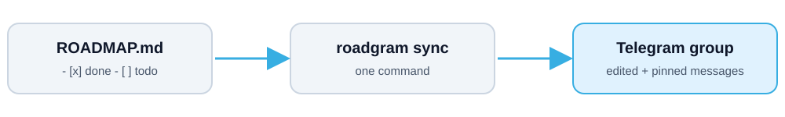

<div align="center">


<br>

[English](README.md) · **فارسی**


[🌐 وبسایت](https://jahaniwww.com) · [📣 کانال تلگرام](https://t.me/tarfandoonchannel)

</div>

---

<div dir="rtl">

## 🆕 چه چیزهایی در نسخه‌ی ۰٫۲٫۰ اضافه شد؟

> **مشتری تحویل را با یک دکمه تأیید می‌کند، فاکتور خودکار می‌رود، و دیگر لازم نیست `roadgram sync` را دستی بزنید.**

- **✅ دکمه‌ی تأیید برای مشتری.** زیر پیام رودمپ هر هفته دو دکمه‌ی شیشه‌ای (inline) هست: **✅ تأیید تحویل** و **✏️ درخواست تغییر**. مشتری یکی را می‌زند. نتیجه در `ROADMAP.md` ثبت می‌شود (`- **تأیید تحویل:** @client · تاریخ`)، در خود پیام نمایش داده می‌شود و برای شما هم پیام خصوصی می‌آید. بحث «تحویل شد یا نشد؟» با یک سابقه‌ی ثبت‌شده در چت و در git تمام می‌شود.
- **✏️ درخواست تغییر یعنی یک کار جدید.** با زدن «درخواست تغییر»، ربات از مشتری می‌خواهد روی پیامش ریپلای کند. متن ریپلای به‌شکل کار باز `- [ ] ✏️ ...` به همان هفته اضافه می‌شود و تأیید از نو لازم می‌شود.
- **💳 پرداخت مرحله‌ای (مایلستون).** به هر هفته یک خط `- **پرداخت:** ۱۰ میلیون تومان` اضافه کنید. با تأیید آن هفته توسط مشتری، فاکتور همراه با `payment_details` شما در تاپیک **💳 پرداخت‌ها** ارسال می‌شود. تا وقتی **💰 پرداخت شد** را نزنید (یا `roadgram paid N` را اجرا نکنید)، هر `payment_reminder_days` روز یک یادآوری می‌رود.
- **🔄 هماهنگی کاملاً خودکار.** `roadgram watch` در پس‌زمینه روشن می‌ماند. با هر ذخیره‌ی `ROADMAP.md` پیام‌های تلگرام در چند ثانیه به‌روز می‌شوند، دکمه‌ها همان لحظه پاسخ می‌گیرند، هفته‌ی اول خودش پست می‌شود و یادآوری‌ها خودشان می‌روند. اگر نمی‌خواهید برنامه‌ای در پس‌زمینه بماند، `roadgram hook install` بعد از هر commit همگام‌سازی می‌کند. `roadgram sync` هم دکمه‌هایی را که از آخرین اجرا زده شده‌اند پردازش می‌کند.
- **🔒 قفل تأیید (اختیاری).** با `"require_approval": true` هفته‌ی بعد فقط بعد از تأیید هفته‌ی جاری توسط مشتری پست می‌شود.
- **دستورهای جدید:** `watch`، `approve N`، `paid N` و `hook install`. با فرستادن `/whoami` به ربات، شناسه‌ی تلگرام خودتان را می‌بینید.
- **ارتقا از نسخه‌ی ۰٫۱** تغییری لازم ندارد: `roadgram.json` و فایل وضعیت قبلی کار می‌کنند و همه‌ی تنظیمات جدید پیش‌فرض امن دارند.

فهرست کامل: [CHANGELOG.md](CHANGELOG.md)

## ✨ roadgram چیست؟

**roadgram** رودمپ، پلن هفتگی و اطلاعیه‌های یک پروژه را داخل یک گروه تلگرام نگه می‌دارد. توسعه‌دهنده و مدیر پروژه (یا کارفرما) بدون هیچ ابزار دیگری، پیشرفت کار را یک‌جا می‌بینند.

</div>

<div align="center">

</div>

<div dir="rtl">

رودمپ را مثل یک چک‌لیست ساده‌ی Markdown در مخزن پروژه می‌نویسید. `roadgram watch` هر ذخیره را می‌بیند و پیام‌های تلگرام را خودش به‌روز می‌کند. مشتری هم با دکمه‌ی زیر پیام، هر هفته را تأیید می‌کند یا درخواست تغییر می‌دهد.

## 🚀 امکانات

| | امکان | توضیح |
|---|---|---|
| 🗺 | **تاپیک رودمپ** | برای هر هفته یک پیام با نوار پیشرفت و ✅/⬜ برای هر کار. همان‌جا ویرایش می‌شود و پین است. |
| 📅 | **پلن هفته‌ی آینده** | اهداف هفته‌ی بعد و کارهای مانده. فقط جدیدترین پلن پین می‌ماند. |
| ⏭ | **پیشروی خودکار** | وقتی همه‌ی کارهای هفته تیک بخورد، رودمپ و پلن هفته‌ی بعد خودکار پست و پین می‌شود. |
| ✅ | **تأیید مشتری** 🆕 | دکمه‌های **✅ تأیید تحویل** و **✏️ درخواست تغییر** زیر هر هفته؛ نتیجه در `ROADMAP.md` ثبت می‌شود. |
| 💳 | **پرداخت مرحله‌ای** 🆕 | با تأیید یک هفته‌ی پولی، فاکتور ارسال می‌شود و تا ثبت پرداخت یادآوری می‌رود. |
| 🔄 | **همگام‌سازی خودکار** 🆕 | `roadgram watch` به هر ذخیره و هر دکمه واکنش نشان می‌دهد. hook گیت هم به‌عنوان جایگزین هست. |
| 📣 | **تاپیک اطلاعیه‌ها** | اطلاعیه و فایل با `roadgram post`، فقط وقتی خودتان بفرستید. |
| 🌍 | **دو زبانه** | پیام‌ها فارسی یا انگلیسی، با تاریخ میلادی، شمسی یا هر دو. |
| 🤖 | **سازگار با ابزارهای هوش مصنوعی** | `roadgram agent install` کار با Claude Code، Codex، Cline، Cursor و Gemini CLI را یادشان می‌دهد. |
| 📦 | **بدون وابستگی** | فقط کتابخانه‌ی استاندارد پایتون، و یک فایل اجرایی تک‌فایلی `roadgram.exe` برای ویندوز. |

## 📥 نصب از صفر

roadgram به **پایتون ۳٫۱۰ یا بالاتر** و **git** نیاز دارد و وابستگی دیگری ندارد. برای ربات هم یک حساب تلگرام لازم است (بخش [شروع سریع](#-شروع-سریع)).

### ویندوز

</div>

```powershell
# ۱. نصب پایتون و git (آنچه دارید را رد کنید)
winget install Python.Python.3.12
winget install Git.Git
# PowerShell را ببندید و دوباره باز کنید، بعد بررسی کنید:
python --version

# ۲. نصب roadgram
python -m pip install git+https://github.com/alipyth/roadgram.git

# ۳. بررسی کارکرد
roadgram --version
```

<div dir="rtl">

اگر `roadgram` شناخته نشد، به‌جایش `python -m roadgram --version` را بزنید، یا پوشه‌ی `Scripts` پایتون را به `PATH` اضافه کنید.

### مک (macOS)

</div>

```bash
# ۱. نصب پایتون و git (با Homebrew: https://brew.sh)
brew install python git
python3 --version

# ۲. نصب roadgram (pipx آن را جدا نگه می‌دارد و دستور roadgram را در PATH می‌گذارد)
brew install pipx && pipx ensurepath
pipx install git+https://github.com/alipyth/roadgram.git

# ۳. بررسی کارکرد (اول یک ترمینال تازه باز کنید)
roadgram --version
```

<div dir="rtl">

### لینوکس (دبیان / اوبونتو؛ توزیع‌های دیگر مدیر بسته‌ی خودشان را دارند)

</div>

```bash
# ۱. نصب پایتون، pip و git
sudo apt update
sudo apt install -y python3 python3-pip pipx git
python3 --version        # باید ۳٫۱۰ یا بالاتر باشد

# ۲. نصب roadgram
pipx ensurepath
pipx install git+https://github.com/alipyth/roadgram.git

# ۳. بررسی کارکرد (اول یک ترمینال تازه باز کنید)
roadgram --version
```

<div dir="rtl">

در فدورا: `sudo dnf install python3 pipx git` و در آرچ: `sudo pacman -S python python-pipx git`.

### از روی clone (هر سیستم‌عامل، برای توسعه)

</div>

```bash
git clone https://github.com/alipyth/roadgram.git
cd roadgram
python -m pip install .            # یا: python -m pip install -e .   (حالت ویرایشی)
python -m unittest discover -s tests -t .      # اختیاری: اجرای تست‌ها
```

<div dir="rtl">

بدون نصب هم می‌توانید مستقیم از داخل clone اجرا کنید: `python -m roadgram --version`.

### به‌روزرسانی و حذف

</div>

```bash
pipx upgrade roadgram          # یا: python -m pip install --upgrade git+https://github.com/alipyth/roadgram.git
pipx uninstall roadgram        # یا: python -m pip uninstall roadgram
```

<div dir="rtl">

### ویندوز: یک فایل `roadgram.exe` (بدون پایتون روی سیستم مقصد)

روی یک سیستم که پایتون دارد یک بار بسازید و `dist\roadgram.exe` را هرجا خواستید کپی کنید:

</div>

```powershell
git clone https://github.com/alipyth/roadgram.git
cd roadgram
powershell -File build_exe.ps1     # تست‌ها را اجرا می‌کند، PyInstaller را نصب می‌کند و dist\roadgram.exe را می‌سازد
.\dist\roadgram.exe --version
```

<div dir="rtl">

## 🧭 اولین اجرا، قدم‌به‌قدم

۱. [آماده‌سازی تلگرام](#۱-آماده‌سازی-تلگرام-یک-بار-حدود-۵-دقیقه) را انجام دهید و **توکن ربات** و **شناسه‌ی گروه** را کنار دستتان داشته باشید.
۲. ترمینال را **داخل پوشه‌ی پروژه** (همان مخزنی که می‌خواهید دنبال کنید) باز کنید.
۳. `roadgram init --name "My App"` فایل‌های `roadgram.json`، `.env` و `ROADMAP.md` را می‌سازد و `.gitignore` را به‌روز می‌کند.
۴. `.env` را باز کنید و مقدارها را بگذارید (مثال زیر):
۵. `ROADMAP.md` را با هفته‌ها و کارهای واقعی خودتان ویرایش کنید.
۶. `roadgram check` باید بگوید توکن، گروه و دسترسی‌ها درست‌اند.
۷. `roadgram week 1 --dry-run` پیام را بدون ارسال نشان می‌دهد.
۸. `roadgram watch` هفته‌ی ۱ و پلن هفته‌ی ۲ را پست می‌کند و روشن می‌ماند. آن را باز بگذارید.
۹. از این به بعد فقط در `ROADMAP.md` تیک بزنید و ذخیره کنید. مشتری هر هفته‌ی تمام‌شده را با دکمه تأیید می‌کند.
۱۰. اختیاری: در چت خصوصی با ربات `/whoami` را بفرستید و عددش را در `"owners"` داخل `roadgram.json` بگذارید. از آن به بعد برای هر تأیید یا درخواست تغییر پیام خصوصی می‌گیرید و ثبت پرداخت هم فقط از دست شما برمی‌آید.

</div>

```ini
# .env
TELEGRAM_BOT_TOKEN=123456:ABC-your-token
TELEGRAM_CHAT_ID=-1001234567890
```

<div dir="rtl">

## 👀 خروجی چه شکلی است؟

نتیجه‌ی `roadgram week 1` (پیامی که در تاپیک تلگرام می‌بینید):

</div>

```text
🗺 هفته ۱: پایه‌گذاری
پیشرفت: ۱ از ۳ کار (۳۳٪)
▰▰▰▱▱▱▱▱▱▱

✅ راه‌اندازی مخزن و CI
⬜ نسخه‌ی اول کارکرد اصلی
⬜ نوشتن تست برای کارکرد اصلی

خروجی هفته: کارکرد اصلی همراه با تست

📅 آخرین به‌روزرسانی: ۱۶ آبان ۱۴۰۵

#رودمپ #هفته۱ #MyApp

[ ✅ تأیید تحویل ]  [ ✏️ درخواست تغییر ]
```

<div dir="rtl">

وقتی مشتری **✅ تأیید تحویل** را بزند، دکمه‌ها برداشته می‌شوند و پیام نشان می‌دهد: `✅ تحویل تأیید شد: @client · ۱۷ آبان ۱۴۰۵`.

</div>

<div dir="rtl">

## ⚡ شروع سریع

### ۱. آماده‌سازی تلگرام (یک بار، حدود ۵ دقیقه)

۱. به **@BotFather** بروید ← `/newbot` ← **توکن** را کپی کنید.
۲. یک گروه بسازید (یا از گروه موجود استفاده کنید) و ربات را اضافه کنید.
۳. برای داشتن یک تاپیک به‌ازای هر بخش، در تنظیمات گروه **Topics** را روشن کنید. بدون تاپیک هم کار می‌کند و پیام‌ها در چت اصلی می‌روند.
۴. ربات را **ادمین** کنید با دسترسی **Pin messages** و (اگر تاپیک روشن است) **Manage topics**.
۵. شناسه‌ی گروه را پیدا کنید (شکلش `-1001234567890` است): یک پیام گروه را برای **@RawDataBot** فوروارد کنید.

> [!IMPORTANT]
> **توکن را محرمانه نگه دارید.** فقط در `.env` می‌ماند و `roadgram init` آن را به `.gitignore` اضافه می‌کند. roadgram هرگز توکن را چاپ، لاگ یا داخل پیام نمی‌گذارد. اگر لو رفت، در @BotFather دستور `/revoke` را بزنید.

### ۲. اجرا

</div>

```powershell
# داخل پوشه‌ی پروژه (roadgram.exe، یا: python -m roadgram ...)
roadgram init --name "My App" --lang fa --calendar jalali   # roadgram.json، .env، ROADMAP.md و .gitignore
# TELEGRAM_BOT_TOKEN و TELEGRAM_CHAT_ID را در .env بگذارید، بعد:
roadgram check                 # توکن، گروه، تاپیک‌ها و دسترسی‌های ربات را بررسی می‌کند
roadgram week 1 --dry-run      # پیش‌نمایش پیام (چیزی نمی‌فرستد)
roadgram week 1                # رودمپ هفته ۱ را پست و پین می‌کند
roadgram plan 2                # پلن هفته ۲ را پست و پین می‌کند
roadgram watch                 # روشن بگذارید: هر ذخیره و هر دکمه‌ی مشتری خودکار همگام می‌شود
# ... کار کنید، در ROADMAP.md تیک بزنید و ذخیره کنید ...
roadgram sync                  # همگام‌سازی یک‌باره به‌جای watch (دکمه‌های زده‌شده را هم می‌خواند)
roadgram approve 1 --by "سارا" # مشتری بیرون از تلگرام تأیید کرد (تلفنی، ایمیل ...)
roadgram paid 1                # پرداخت هفته ۱ رسید
roadgram post --text "نسخه‌ی آزمایشی آماده است" --pin
roadgram post --document report.pdf --text "گزارش هفتگی"
roadgram status                # پیشرفت را در ترمینال نشان می‌دهد، چیزی نمی‌فرستد
```

<div dir="rtl">

> [!TIP]
> اگر `roadgram watch` روشن باشد، هیچ‌وقت به `roadgram sync` نیاز ندارید. اگر برنامه‌ی پس‌زمینه نمی‌خواهید، از `roadgram hook install` استفاده کنید تا بعد از هر `git commit` همگام‌سازی شود.

### ۳. فایل رودمپ

</div>

```markdown
## هفته ۱: پایه‌گذاری
- [x] راه‌اندازی مخزن و CI
- [ ] نسخه‌ی اول کارکرد اصلی
- **چک‌پوینت ۱: جمعه**          (اختیاری، در پلن نشان داده می‌شود)
- **خروجی:** کارکرد اصلی آماده     (اختیاری)
- **پرداخت:** ۱۰ میلیون تومان       (اختیاری؛ پرداخت مرحله‌ای، با تأیید هفته فاکتور می‌شود)
- **تأیید تحویل:** @client · ۱۷ آبان ۱۴۰۵   (با دکمه‌ی مشتری، توسط roadgram نوشته می‌شود)
- **پرداخت شد:** ۲۱ آبان ۱۴۰۵       (با ثبت پرداخت، توسط roadgram نوشته می‌شود)

## هفته ۲: انتشار
- [ ] ✏️ لوگو بزرگ‌تر شود (@client, ۱۷ آبان ۱۴۰۵)   (درخواست تغییر که roadgram اضافه کرده)
- [ ] ...
```

<div dir="rtl">

خط‌های داخل `<!-- ... -->` نادیده گرفته می‌شوند؛ می‌توانید خط پرداخت را تا وقت لازم آنجا نگه دارید.

</div>

<div dir="rtl">

عنوان `## هفته N: ...` (یا `Week` / `Sprint` / `Phase` / `Milestone` انگلیسی) یک هفته را شروع می‌کند و خط‌های `- [ ]` و `- [x]` کارهای آن هستند.

## ✅ تأیید مشتری و پرداخت مرحله‌ای

این بخش برای کار فریلنسری و آژانسی است، جایی که پروژه‌ها معمولاً سر «تحویل شد یا نشد؟» گیر می‌کنند.

۱. زیر پیام رودمپ هر هفته دو دکمه می‌آید: **✅ تأیید تحویل** و **✏️ درخواست تغییر**.
۲. **تأیید:** roadgram زیر همان هفته در `ROADMAP.md` خط `- **تأیید تحویل:** @client · تاریخ` را می‌نویسد، دکمه‌ها را برمی‌دارد، تأیید را در پیام نشان می‌دهد و به همه‌ی `owners` پیام خصوصی می‌دهد. اگر هفته خط `- **پرداخت:**` داشته باشد، فاکتور در تاپیک **💳 پرداخت‌ها** ارسال می‌شود.
۳. **درخواست تغییر:** ربات از مشتری می‌خواهد روی پیامش ریپلای کند. متن ریپلای به‌صورت کار باز `- [ ] ✏️ ... (@client, تاریخ)` به هفته اضافه می‌شود، تأیید قبلی (اگر بود) برداشته می‌شود و برای شما پیام خصوصی می‌آید. تغییر حالا مثل بقیه‌ی کارها در چک‌لیست است.
۴. **پرداخت:** فاکتور مبلغ، تأییدکننده و `payment_details` شما (شماره کارت، شبا، لینک پرداخت ...) را نشان می‌دهد. تا پرداخت نشده، هر `payment_reminder_days` روز یک یادآوری می‌رود. دکمه‌ی **💰 پرداخت شد** را بزنید (فقط owners) یا `roadgram paid N` را اجرا کنید. خط `- **پرداخت شد:** تاریخ` نوشته و فاکتور به‌روز می‌شود.

**مشتری چه کسی حساب می‌شود؟** به‌طور پیش‌فرض هر عضو گروه که در `owners` نیست. برای محدود کردن، شناسه یا `@username` مشتری را در `approvers` بگذارید. اگر شخص دیگری دکمه را بزند، پیام کوتاه «فقط مشتری می‌تواند ...» می‌بیند.

**راه‌اندازی (یک دقیقه):**

</div>

```jsonc
// roadgram.json
"owners": [123456789],                 // شناسه‌ی شما (با /whoami از ربات بگیرید)؛ پیام خصوصی و ثبت پرداخت
"approvers": ["@client_username"],     // اختیاری؛ خالی = هر کسی که owner نیست
"payment_details": "کارت ۶۰۳۷-.... / شبا IR.. / https://pay.example/inv",
"payment_reminder_days": 3,            // 0 = بدون یادآوری
"require_approval": false              // true = هفته‌ی بعد منتظر تأیید مشتری می‌ماند
```

<div dir="rtl">

هر owner باید یک بار در چت خصوصی با ربات **Start** را بزند، وگرنه تلگرام اجازه نمی‌دهد ربات به او پیام بدهد. لازم نیست ربات همه‌ی پیام‌های گروه را بخواند (Privacy mode می‌تواند روشن بماند). ربات فقط زدن دکمه‌ها، ریپلای روی پیام‌های خودش و دستورهایی مثل `/whoami` را دریافت می‌کند.

## 🔄 همگام‌سازی خودکار

| روش | کاربرد |
|---|---|
| `roadgram watch` | پیشنهادی. روشن می‌ماند و حدود ۳ ثانیه بعد از هر ذخیره همگام می‌کند. دکمه‌ها را همان لحظه جواب می‌دهد، یادآوری می‌فرستد و هفته‌ی ۱ را خودش شروع می‌کند. |
| `roadgram watch --once` | یک دور اجرا و خروج. برای cron یا Task Scheduler ویندوز، هر چند دقیقه یک بار. |
| `roadgram hook install` | بدون برنامه‌ی پس‌زمینه: hook گیت `post-commit` بعد از هر commit دستور `roadgram sync` را اجرا می‌کند. `--uninstall` آن را برمی‌دارد. |
| `roadgram sync` | دستی. دکمه‌هایی را که از آخرین اجرا زده شده‌اند هم پردازش می‌کند. |

روشن نگه داشتن `watch` در پس‌زمینه:

</div>

```bash
# لینوکس / مک: داخل پوشه‌ی پروژه
nohup roadgram watch > .roadgram/watch.log 2>&1 &

# لینوکس: به‌صورت سرویس systemd کاربر (~/.config/systemd/user/roadgram.service)
#   [Service]
#   WorkingDirectory=/path/to/project
#   ExecStart=%h/.local/bin/roadgram watch
#   Restart=always
#   [Install]
#   WantedBy=default.target
systemctl --user enable --now roadgram
```

```powershell
# ویندوز: یک پنجره‌ی کوچک‌شده که روشن می‌ماند
Start-Process -WindowStyle Minimized roadgram -ArgumentList "watch" -WorkingDirectory "C:\path\to\project"
```

<div dir="rtl">

## 🤖 استفاده از داخل ابزارهای هوش مصنوعی

</div>

```powershell
roadgram agent install            # ابزارهای نصب‌شده را خودکار پیدا و نصب می‌کند
roadgram agent install all        # یا نام ببرید: claude codex cline cursor gemini
roadgram agent install --global   # برای کل کاربر، نه فقط همین پروژه
roadgram agent install --uninstall
```

<div dir="rtl">

برای هر ابزار فرمت خودش نوشته می‌شود: skill و دستور `/roadgram-sync` برای Claude Code (با `.claude-plugin`)، یک بلوک علامت‌دار در `AGENTS.md` (Codex) و `GEMINI.md`، فایل `.clinerules/roadgram.md` (Cline) و `.cursor/rules/roadgram.mdc` (Cursor). اجرای دوباره فقط به‌روز می‌کند و متن خودتان دست‌نخورده می‌ماند. به agent گفته شده هرگز `.env` را نخواند.

## 📖 دستورها

| دستور | کار |
|---|---|
| `roadgram init` | `roadgram.json`، الگوی `.env`، یک `ROADMAP.md` نمونه و ورودی‌های `.gitignore` را می‌سازد. بدون `--force` چیزی را بازنویسی نمی‌کند. |
| `roadgram check` | توکن، گروه، تاپیک‌ها و دسترسی ادمین ربات را بررسی می‌کند. |
| `roadgram week N [--dry-run]` | پیام رودمپ هفته‌ی N را پست یا ویرایش می‌کند (بار اول پین می‌شود). |
| `roadgram plan N [--dry-run]` | پیام پلن هفته‌ی N را پست یا ویرایش می‌کند؛ پلن‌های قدیمی از پین درمی‌آیند. |
| `roadgram sync` | دکمه‌های زده‌شده را پردازش می‌کند، همه‌ی پیام‌ها را ویرایش می‌کند، با کامل شدن هفته هفته‌ی بعد را پست می‌کند و فاکتور و یادآوری می‌فرستد. |
| `roadgram watch [--interval S] [--once]` | 🆕 روشن می‌ماند و با هر ذخیره‌ی رودمپ و هر دکمه، همه‌ی کارهای `sync` را انجام می‌دهد. |
| `roadgram approve N [--by NAME] [--undo]` | 🆕 تأیید مشتری برای هفته‌ی N را ثبت می‌کند (برای تأییدی که بیرون از تلگرام داده شده). |
| `roadgram paid N [--undo]` | 🆕 پرداخت مرحله‌ای هفته‌ی N را دریافت‌شده ثبت می‌کند. |
| `roadgram hook install [--uninstall]` | 🆕 hook گیت post-commit که `roadgram sync` را در پس‌زمینه اجرا می‌کند. |
| `roadgram post` | پیام یا فایل **جدید** به یک تاپیک می‌فرستد (`--topic`، `--text`، `--file`، `--document`، `--pin`، `--raw-html`، `--dry-run`). |
| `roadgram status` | پیشرفت را از فایل رودمپ چاپ می‌کند. |
| `roadgram agent install` | دستورالعمل roadgram را برای ابزارهای هوش مصنوعی نصب می‌کند. |

گزینه‌ی کلی: `--dir <پوشه>` (پیش‌فرض پوشه‌ی جاری؛ `roadgram.json` به سمت بالا جست‌وجو می‌شود).

## ⚙️ تنظیمات (`roadgram.json`)

| کلید | معنی | پیش‌فرض |
|---|---|---|
| `project` | نام پروژه | نام پوشه |
| `hashtag` | هشتگ پیام‌ها (`""` یعنی هیچ) | نام بدون فاصله |
| `language` | `en` یا `fa` | `en` |
| `calendar` | `gregorian`، `jalali` یا `both` | `gregorian` |
| `roadmap_file` | مسیر فایل رودمپ | `ROADMAP.md` |
| `topics` | نام تاپیک‌ها بر اساس کلید: `roadmap`، `plan`، `updates`، `payments` (برای `roadgram post --topic` کلید خودتان را اضافه کنید) | بسته به زبان |
| `max_item_len` | بیشینه‌ی طول متن هر کار در پیام | `120` |
| `advance` | با کامل شدن هفته‌ی جاری، هفته‌ی بعد خودکار پست شود | `true` |
| `auto_start` 🆕 | وقتی هنوز چیزی پست نشده، اولین هفته‌ی باز خودش پست شود | `true` |
| `approval` 🆕 | دکمه‌های ✅ / ✏️ زیر هر هفته | `true` |
| `require_approval` 🆕 | پیشروی فقط بعد از تأیید هفته‌ی جاری توسط مشتری | `false` |
| `owners` 🆕 | شناسه‌ی تلگرام شما: پیام خصوصی و تنها کسانی که پرداخت را ثبت می‌کنند | `[]` |
| `approvers` 🆕 | شناسه یا `@username` مشتری؛ خالی = هر کسی که owner نیست | `[]` |
| `payment_details` 🆕 | متنی که روی فاکتور می‌آید (کارت، شبا، لینک پرداخت ...) | `""` |
| `payment_reminder_days` 🆕 | فاصله‌ی یادآوری‌های پرداخت به روز (`0` = بدون یادآوری) | `3` |

شناسه‌ی پیام‌ها و تاپیک‌ها، فاکتورها و شماره‌ی آخرین آپدیت در `.roadgram/state.json` می‌ماند. اگر پیامی را در تلگرام پاک کردید، شناسه‌اش را از این فایل بردارید تا اجرای بعد پیام تازه بفرستد.

## 🛠 ساخت فایل اجرایی

</div>

```powershell
powershell -File build_exe.ps1     # اول تست‌ها را اجرا می‌کند، بعد dist\roadgram.exe را با PyInstaller می‌سازد
```

<div dir="rtl">

فقط تست‌ها: `python -m unittest discover -s tests -t .`

## 🔒 نکته‌ها و محدودیت‌ها

- roadgram فقط چیزی را می‌فرستد که از رودمپ و دستورهای شما نتیجه می‌شود. از گروه فقط زدن دکمه‌ها، ریپلای روی پیام‌های خودش و دستورهای ربات را می‌بیند (Privacy mode می‌تواند روشن بماند).
- برای هر ربات فقط یک `roadgram watch` اجرا کنید. تلگرام فقط یک خواننده‌ی آپدیت را قبول می‌کند و وقتی watch روشن است، `sync` سراغ آپدیت‌ها نمی‌رود.
- توکن هیچ‌وقت در خروجی و خطاها نمی‌آید؛ در خطای شبکه فقط نوع خطا نشان داده می‌شود.
- پیام تلگرام حداکثر ۴۰۹۶ نویسه دارد. هفته‌های طولانی با «… و N مورد دیگر» کوتاه می‌شوند.
- ویرایشگرهای ویندوز ممکن است به `.env` و `roadgram.json` یک BOM اضافه کنند؛ roadgram هر دو را درست می‌خواند.

</div>

---

<div align="center">

مجوز MIT · ساخته‌ی [علی جهانی](https://jahaniwww.com)

</div>
