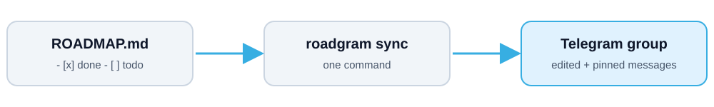

<div align="center">


<br>

**English** · [فارسی](README.fa.md)


[🌐 Website](https://jahaniwww.com) · [📣 Telegram channel](https://t.me/tarfandoonchannel)

</div>

---

## 🆕 What's new in v0.2.0

> **Clients approve deliveries with one tap, invoices go out on their own, and you never type `roadgram sync` again.**

- **✅ Client approval buttons.** Every weekly roadmap message now has two inline buttons: **✅ Approve delivery** and **✏️ Request changes**. The client taps one and the result is written back into `ROADMAP.md` (`- **Approved:** @client · date`), shown in the message, and sent to you as a private message. "Was it delivered or not?" is settled by a record in the chat and in git.
- **✏️ Change requests become tasks.** "Request changes" asks the client to reply. The reply is added to that week as a new open task `- [ ] ✏️ ...` and the approval starts over.
- **💳 Milestone payments.** Add `- **Payment:** 500 USD` to a week. When the client approves it, an invoice is posted to a **💳 Payments** topic with your `payment_details`. A reminder follows every `payment_reminder_days` days until you tap **💰 Mark as paid** (or run `roadgram paid N`).
- **🔄 Fully automatic sync.** `roadgram watch` keeps running. Saving `ROADMAP.md` updates Telegram within seconds, button presses are handled live, the first week is posted on its own and reminders go out by themselves. If you would rather not keep a process running, `roadgram hook install` syncs after every git commit, and `roadgram sync` also picks up button presses made since its last run.
- **🔒 Optional approval gate.** With `"require_approval": true`, the next week is only posted after the client approves the current one.
- **New commands:** `watch`, `approve N`, `paid N` and `hook install`. Send `/whoami` to the bot to see your Telegram id.
- **Upgrading from 0.1** needs no changes: old `roadgram.json` and state files keep working, and every new setting has a safe default.

See [CHANGELOG.md](CHANGELOG.md) for the full list.

## ✨ What is roadgram?

**roadgram** keeps a project's roadmap, weekly plan and announcements inside a Telegram group, so a developer and a project manager (or a client) can follow progress in one place, with no other tool.

<div align="center">

</div>

You write the roadmap as a normal Markdown checklist in your repository. `roadgram watch` notices every save and updates the Telegram messages itself. Your client approves each week, or asks for changes, with a button under the message.

## 🚀 Features

| | Feature | Details |
|---|---|---|
| 🗺 | **Roadmap topic** | One message per week with a progress bar and ✅/⬜ per task. Edited in place, pinned. |
| 📅 | **Next-week plan** | Goals of the coming week plus what is still open. Only the newest plan stays pinned. |
| ⏭ | **Auto-advance** | When every task of the week is ticked, the next roadmap and plan are posted and pinned. |
| ✅ | **Client approval** 🆕 | **✅ Approve delivery** / **✏️ Request changes** buttons under every week; the result lands in `ROADMAP.md`. |
| 💳 | **Milestone payments** 🆕 | An invoice is posted when a paid week is approved, with reminders until it is marked paid. |
| 🔄 | **Automatic sync** 🆕 | `roadgram watch` reacts to every save and every button press. A git hook is available as an alternative. |
| 📣 | **Updates topic** | Announcements and files with `roadgram post`, only when you send them. |
| 🌍 | **Two languages** | Messages in English or Persian, with Gregorian, Jalali or both dates. |
| 🤖 | **AI agent ready** | `roadgram agent install` teaches Claude Code, Codex, Cline, Cursor and Gemini CLI to use it. |
| 📦 | **Zero dependencies** | Standard library only, plus a single-file `roadgram.exe` for Windows. |

## 📥 Install from scratch

roadgram needs **Python 3.10 or newer** and **git**. It has no other dependencies. A Telegram account is needed for the bot (see [Quick start](#-quick-start)).

### Windows

```powershell
# 1. Install Python and git (skip what you already have)
winget install Python.Python.3.12
winget install Git.Git
# close and reopen PowerShell, then check:
python --version

# 2. Install roadgram
python -m pip install git+https://github.com/alipyth/roadgram.git

# 3. Check it works
roadgram --version
```

If `roadgram` is "not recognized", use `python -m roadgram --version` instead, or add Python's `Scripts` folder to `PATH`.

### macOS

```bash
# 1. Install Python and git (with Homebrew: https://brew.sh)
brew install python git
python3 --version

# 2. Install roadgram (pipx keeps it isolated and puts `roadgram` on your PATH)
brew install pipx && pipx ensurepath
pipx install git+https://github.com/alipyth/roadgram.git

# 3. Check it works (open a new terminal first)
roadgram --version
```

### Linux (Debian / Ubuntu; other distros use their own package manager)

```bash
# 1. Install Python, pip and git
sudo apt update
sudo apt install -y python3 python3-pip pipx git
python3 --version        # must be 3.10 or newer

# 2. Install roadgram
pipx ensurepath
pipx install git+https://github.com/alipyth/roadgram.git

# 3. Check it works (open a new terminal first)
roadgram --version
```

On Fedora use `sudo dnf install python3 pipx git`, on Arch `sudo pacman -S python python-pipx git`.

### From a clone (any OS, for development)

```bash
git clone https://github.com/alipyth/roadgram.git
cd roadgram
python -m pip install .            # or: python -m pip install -e .   (editable)
python -m unittest discover -s tests -t .      # optional: run the tests
```

You can also skip installing and run it straight from the clone: `python -m roadgram --version`.

### Update and uninstall

```bash
pipx upgrade roadgram          # or: python -m pip install --upgrade git+https://github.com/alipyth/roadgram.git
pipx uninstall roadgram        # or: python -m pip uninstall roadgram
```

### Windows: a single `roadgram.exe` (no Python on the target PC)

On a PC that has Python, build it once and copy `dist\roadgram.exe` anywhere:

```powershell
git clone https://github.com/alipyth/roadgram.git
cd roadgram
powershell -File build_exe.ps1     # runs the tests, installs PyInstaller, builds dist\roadgram.exe
.\dist\roadgram.exe --version
```

## 🧭 Your first run, step by step

1. Do the [Telegram setup](#1-set-up-telegram-once-5-minutes) and keep the **bot token** and **group id** at hand.
2. Open a terminal **in your project folder** (the repo you want to track).
3. `roadgram init --name "My App"` creates `roadgram.json`, `.env`, `ROADMAP.md` and updates `.gitignore`.
4. Open `.env` and paste your values:
   ```ini
   TELEGRAM_BOT_TOKEN=123456:ABC-your-token
   TELEGRAM_CHAT_ID=-1001234567890
   ```
5. Edit `ROADMAP.md` to your real weeks and tasks.
6. `roadgram check` must report that the token, group and rights are fine.
7. `roadgram week 1 --dry-run` shows the message without sending it.
8. `roadgram watch` posts week 1 and the plan of week 2, then keeps running. Leave it open.
9. From now on just tick tasks in `ROADMAP.md` and save. The client approves each finished week with the buttons.
10. Optional: send `/whoami` to your bot in a private chat and put the number in `"owners"` in `roadgram.json`. You then get a private message for every approval or change request, and only you can mark payments as received.

## 👀 What it looks like

Output of `roadgram week 1` (a message in your Telegram topic):

```text
🗺 Week 1: Foundation
Progress: 1 of 3 tasks (33%)
▰▰▰▱▱▱▱▱▱▱

✅ Set up the repository and CI
⬜ Write the first working version of the core feature
⬜ Write tests for the core feature

Week output: a working core feature with tests

📅 Last updated: 7 November 2026

#roadmap #week1 #MyApp

[ ✅ Approve delivery ]  [ ✏️ Request changes ]
```

When the client taps **✅ Approve delivery**, the buttons go away and the message shows `✅ Delivery approved: @client · 8 November 2026`.

## ⚡ Quick start

### 1. Set up Telegram (once, ~5 minutes)

1. Open **@BotFather** → `/newbot` → copy the **token**.
2. Create a group (or use an existing one) and add the bot.
3. For one topic per section, turn on **Topics** in the group settings. Without topics roadgram still works and posts to the main chat.
4. Make the bot an **admin** with **Pin messages** and, if topics are on, **Manage topics**.
5. Find the group id (like `-1001234567890`): forward a group message to **@RawDataBot**.

> [!IMPORTANT]
> **Keep the token secret.** It lives only in `.env`, which `roadgram init` adds to `.gitignore`. roadgram never prints it, logs it or writes it into messages. If it leaks, run `/revoke` in @BotFather.

### 2. Run it

```powershell
# in your project folder (roadgram.exe, or: python -m roadgram ...)
roadgram init --name "My App" --lang en --calendar gregorian   # roadgram.json, .env, ROADMAP.md, .gitignore
# put TELEGRAM_BOT_TOKEN and TELEGRAM_CHAT_ID into .env, then:
roadgram check                 # verifies token, group, topics and the bot's rights
roadgram week 1 --dry-run      # preview the message (sends nothing)
roadgram week 1                # post (and pin) the roadmap of week 1
roadgram plan 2                # post (and pin) the plan of week 2
roadgram watch                 # keep this running: every save + every client button is synced automatically
# ... work, tick tasks in ROADMAP.md, save ...
roadgram sync                  # one-off sync instead of watch (also picks up button presses)
roadgram approve 1 --by Sara   # the client approved outside Telegram (by phone, email ...)
roadgram paid 1                # the payment of week 1 arrived
roadgram post --text "Release candidate is ready" --pin
roadgram post --document report.pdf --text "Weekly report"
roadgram status                # progress in the terminal, sends nothing
```

> [!TIP]
> Keep `roadgram watch` running and you never need `roadgram sync`. To avoid a background process, use `roadgram hook install`, which syncs after every `git commit`.

### 3. The roadmap file

```markdown
## Week 1: Foundation
- [x] Set up the repository and CI
- [ ] First working version of the core feature
- **Checkpoint 1: Friday**              (optional, shown in the plan)
- **Output:** a working core feature    (optional)
- **Payment:** 500 USD                  (optional milestone payment, invoiced on approval)
- **Approved:** @client · 8 November 2026   (written by roadgram when the client taps the button)
- **Paid:** 12 November 2026            (written by roadgram when the payment is marked as received)

## Week 2: Launch
- [ ] ✏️ Make the logo bigger (@client, 8 November 2026)   (a change request, added by roadgram)
- [ ] ...
```

Lines inside `<!-- ... -->` are ignored, so you can keep a payment line there until you need it.

A heading `## Week N: ...` (also `Sprint`, `Phase`, `Milestone`, or Persian `## هفته N: ...`) starts a week. `- [ ]` and `- [x]` lines are its tasks.

## ✅ Client approval and milestone payments

This is for freelance and agency work, where projects tend to stall on "was it delivered or not?".

1. Every weekly roadmap message gets two buttons: **✅ Approve delivery** and **✏️ Request changes**.
2. **Approve:** roadgram writes `- **Approved:** @client · date` under that week in `ROADMAP.md`, removes the buttons, shows the approval in the message and sends a private message to every `owner`. If the week has a `- **Payment:**` line, an invoice is posted in the **💳 Payments** topic.
3. **Request changes:** the bot asks the client to reply to its message. The reply is added to the week as an open task `- [ ] ✏️ ... (@client, date)`, any earlier approval is removed, and you get a private message. The change is now on the checklist like any other task.
4. **Payment:** the invoice shows the amount, who approved it and your `payment_details` (card number, IBAN, payment link ...). Until it is paid, a reminder is posted every `payment_reminder_days` days. Tap **💰 Mark as paid** (owners only) or run `roadgram paid N`; this writes `- **Paid:** date` and updates the invoice.

**Who counts as the client?** By default, anyone in the group who is not listed in `owners`. To restrict it, list the client's id or `@username` in `approvers`. Others who tap a button get a short "only the client can ..." notice.

**Setup (one minute):**

```jsonc
// roadgram.json
"owners": [123456789],                 // your id (send /whoami to the bot); you get DMs, you mark payments
"approvers": ["@client_username"],     // optional; empty = anyone who is not an owner
"payment_details": "Card 6037-.... / IBAN IR.. / https://pay.example/inv",
"payment_reminder_days": 3,            // 0 = no reminders
"require_approval": false              // true = the next week waits for the client's approval
```

Owners have to press **Start** in a private chat with the bot once, or Telegram will not let the bot message them. The bot does not need to read every group message (privacy mode can stay on). It only receives button taps, replies to its own messages and commands such as `/whoami`.

## 🔄 Automatic sync

| Option | When to use it |
|---|---|
| `roadgram watch` | Recommended. Keeps running and syncs within ~3 seconds of every save. Handles buttons live, sends reminders and starts week 1 on its own. |
| `roadgram watch --once` | One round, then exit. Use it from cron or the Windows Task Scheduler every few minutes. |
| `roadgram hook install` | No background process: a git `post-commit` hook runs `roadgram sync` after every commit. `--uninstall` removes it. |
| `roadgram sync` | By hand. It also handles button presses made since the last run. |

Keeping `watch` running in the background:

```bash
# Linux / macOS: in the project folder
nohup roadgram watch > .roadgram/watch.log 2>&1 &

# Linux: as a systemd user service (~/.config/systemd/user/roadgram.service)
#   [Service]
#   WorkingDirectory=/path/to/project
#   ExecStart=%h/.local/bin/roadgram watch
#   Restart=always
#   [Install]
#   WantedBy=default.target
systemctl --user enable --now roadgram
```

```powershell
# Windows: minimised window that keeps running
Start-Process -WindowStyle Minimized roadgram -ArgumentList "watch" -WorkingDirectory "C:\path\to\project"
```

## 🤖 Use it from AI coding agents

```powershell
roadgram agent install            # auto-detects Claude Code, Codex, Cline, Cursor, Gemini CLI
roadgram agent install all        # or name them: claude codex cline cursor gemini
roadgram agent install --global   # for your user instead of only this project
roadgram agent install --uninstall
```

It writes each tool's own format: a skill and `/roadgram-sync` command for Claude Code (plus a `.claude-plugin`), a marked block in `AGENTS.md` (Codex) and `GEMINI.md`, `.clinerules/roadgram.md` (Cline) and `.cursor/rules/roadgram.mdc` (Cursor). Re-running updates in place and keeps your own text. The agent is told never to read `.env`.

## 📖 Commands

| Command | What it does |
|---|---|
| `roadgram init` | Creates `roadgram.json`, a `.env` template, a sample `ROADMAP.md` and `.gitignore` entries. Never overwrites without `--force`. |
| `roadgram check` | Checks token, group, topics and the bot's admin rights. |
| `roadgram week N [--dry-run]` | Posts or edits the roadmap message of week N (pinned on first post). |
| `roadgram plan N [--dry-run]` | Posts or edits the plan message of week N; older plans are unpinned. |
| `roadgram sync` | Handles pending button presses, edits all posted messages, advances when the current week is done, sends invoices and reminders. |
| `roadgram watch [--interval S] [--once]` | 🆕 Keeps running and does everything `sync` does on every save of the roadmap and every button press. |
| `roadgram approve N [--by NAME] [--undo]` | 🆕 Records the client's approval of week N (for approvals given outside Telegram). |
| `roadgram paid N [--undo]` | 🆕 Marks the milestone payment of week N as received. |
| `roadgram hook install [--uninstall]` | 🆕 Git post-commit hook that runs `roadgram sync` in the background. |
| `roadgram post` | Sends a **new** message or file to a topic (`--topic`, `--text`, `--file`, `--document`, `--pin`, `--raw-html`, `--dry-run`). |
| `roadgram status` | Prints progress from the roadmap file. |
| `roadgram agent install` | Installs roadgram instructions for AI coding agents. |

Global option: `--dir <folder>` (default: current folder; `roadgram.json` is searched upwards).

## ⚙️ Configuration (`roadgram.json`)

| Key | Meaning | Default |
|---|---|---|
| `project` | Name | folder name |
| `hashtag` | Hashtag added to messages (`""` = none) | name without spaces |
| `language` | `en` or `fa` | `en` |
| `calendar` | `gregorian`, `jalali` or `both` | `gregorian` |
| `roadmap_file` | Path to the Markdown roadmap | `ROADMAP.md` |
| `topics` | Topic names by key: `roadmap`, `plan`, `updates`, `payments` (add your own keys for `roadgram post --topic`) | per language |
| `max_item_len` | Longest task text in a message | `120` |
| `advance` | Auto-post the next week when the current one is done | `true` |
| `auto_start` 🆕 | Post the first open week by itself when nothing is posted yet | `true` |
| `approval` 🆕 | Show the ✅ / ✏️ buttons under every week | `true` |
| `require_approval` 🆕 | Advance only after the client approved the current week | `false` |
| `owners` 🆕 | Your Telegram id(s): private notifications, the only ones who can mark payments | `[]` |
| `approvers` 🆕 | Client id(s) or `@username`(s) allowed to approve; empty = anyone who is not an owner | `[]` |
| `payment_details` 🆕 | Text shown on invoices (card, IBAN, payment link ...) | `""` |
| `payment_reminder_days` 🆕 | Days between payment reminders (`0` = none) | `3` |

State (message and topic ids, invoices, the update offset) is kept in `.roadgram/state.json`. If you delete a message in Telegram, remove its id from that file and the next run posts a new one.

## 🛠 Build the executable

```powershell
powershell -File build_exe.ps1     # runs the tests, then builds dist\roadgram.exe with PyInstaller
```

Run the tests alone: `python -m unittest discover -s tests -t .`

## 🔒 Notes and limits

- roadgram only sends what follows from your roadmap and your commands. Of the group, it only sees button taps, replies to its own messages and bot commands (privacy mode can stay on).
- Run only one `roadgram watch` per bot. Telegram allows a single update reader, and `sync` skips reading updates while a watcher is running.
- The token never appears in output or errors; network errors show only the error class.
- Telegram messages are limited to 4096 characters. Long weeks are shortened with "… and N more".
- Windows editors may add a BOM to `.env` and `roadgram.json`; roadgram reads both correctly.

---

<div align="center">

MIT License · Made by [Ali Jahani](https://jahaniwww.com)

</div>
